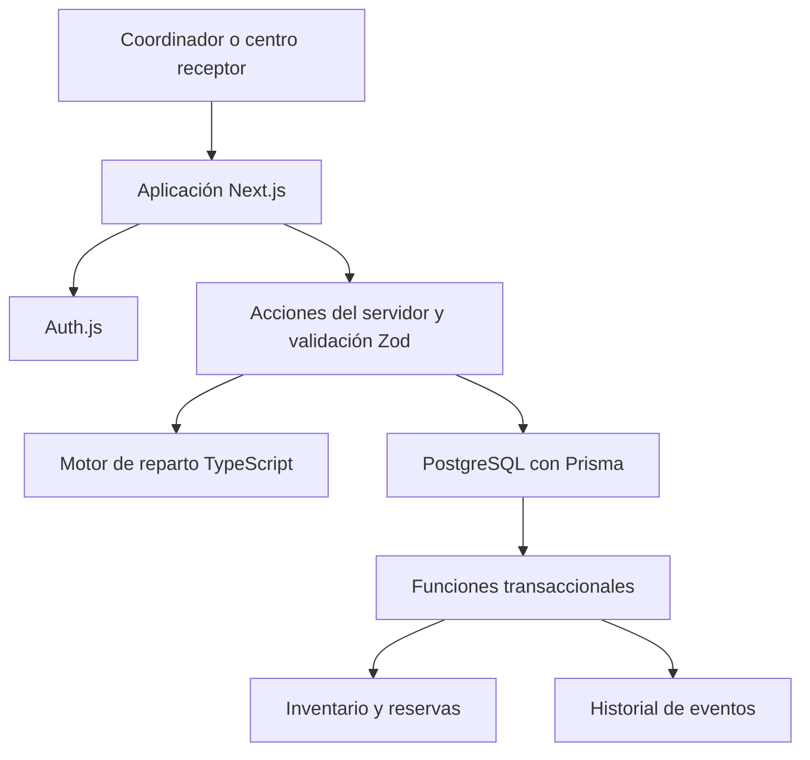

# Donaciones donde hacen falta

Plan de producto, arquitectura y desarrollo para EvoHacks 2. Documento de trabajo del 22 de noviembre de 2026.

## 1. Objetivo

Construir una aplicación web que ayude a una organización coordinadora a distribuir donaciones materiales entre centros comunitarios según sus necesidades declaradas. La aplicación registra inventario, recibe solicitudes, propone un reparto explicable, reserva existencias y confirma las entregas.

El resultado observable será que un coordinador pueda responder cuánto recibe cada centro, cómo se calculó y qué necesidad sigue pendiente.

### Encaje con EvoHacks 2

La propuesta aborda un problema real y permite demostrar un flujo funcional. El tema oficial específico sigue pendiente de verificación en las páginas públicas consultadas. Antes de cerrar el alcance, registrar aquí el enunciado recibido del organizador y relacionarlo con una función central del producto.

- Enunciado oficial por confirmar.
- Conexión del flujo principal con el enunciado por completar.
- Componentes obligatorios adicionales por confirmar.

El plan tecnológico y las reglas de reparto siguientes son decisiones propuestas para el prototipo. Deben validarse con una organización antes de un uso operativo.

## 2. Alcance de la primera versión

Trabajar con una organización coordinadora, tres centros receptores, una campaña y un producto divisible en unidades enteras, como kits de higiene. Cada centro declara la cantidad que necesita durante esa campaña. El coordinador registra las unidades recibidas y genera una propuesta.

### Funciones necesarias

1. Iniciar sesión con una cuenta de coordinador o de centro receptor.
2. Registrar una entrada de inventario con cantidad y referencia.
3. Crear o actualizar una solicitud de unidades para la campaña.
4. Calcular una propuesta con explicación por centro.
5. Revisar y confirmar el reparto.
6. Reservar el inventario de forma atómica.
7. Registrar la entrega o cancelar una asignación pendiente.
8. Consultar movimientos e historial de decisiones.

### Ampliaciones posteriores

Varios productos y almacenes, caducidades por lote, rutas de transporte, prioridades acordadas con organizaciones, notificaciones y adjuntos. Incorporarlas después de verificar el flujo completo de la primera versión.

## 3. Usuarios y permisos

| Acción | Coordinador | Centro receptor |
| --- | --- | --- |
| Consultar inventario y reparto global | Sí | Solo sus asignaciones |
| Registrar entradas | Sí | Sin permiso |
| Editar solicitud | Todas con registro de autor | Solo la propia |
| Generar y confirmar propuesta | Sí | Sin permiso |
| Registrar entrega | Sí | Puede consultar su estado |
| Consultar historial | Global | Solo eventos propios |

Las cuentas de centros se crean mediante invitación para el prototipo. Guardar necesidades agregadas y datos de contacto del centro. Los beneficiarios se representan mediante cantidades agregadas.

## 4. Regla de reparto

Usar reparto proporcional sobre la necesidad pendiente. La primera versión trata todas las solicitudes con la misma prioridad. Las cantidades declaradas deben corresponder a la misma campaña y unidad de producto.

1. Calcular la necesidad pendiente de cada centro como solicitado menos entregado menos reservado.
2. Sumar las necesidades pendientes válidas.
3. Si hay inventario suficiente, asignar a cada centro toda su necesidad pendiente.
4. Si hay escasez, calcular la cuota como disponible multiplicado por necesidad individual y dividido por necesidad total.
5. Tomar la parte entera de cada cuota.
6. Distribuir las unidades restantes por mayor resto decimal, con desempate estable por identificador del centro.
7. Mostrar las entradas utilizadas, la cantidad propuesta y el pendiente posterior.

Ejemplo de escasez con 90 kits disponibles y necesidades de 80, 60 y 40. Las propuestas son 40, 30 y 20. Los pendientes posteriores son 40, 30 y 20. Al disponer de 120 kits, las propuestas son 53, 40 y 27.

El cálculo debe ser una función pura en TypeScript. Debe devolver cantidades y motivos legibles. Guardar la versión del algoritmo junto a las entradas utilizadas. La distribución proporcional es una regla inicial acordable y sus resultados dependen de la calidad de las necesidades declaradas.

### Casos especiales

- Cantidades negativas, fraccionarias o vacías producen un error de validación.
- Con inventario cero, mostrar cantidades cero y el motivo.
- Con demanda cero, conservar todo el inventario disponible.
- El excedente permanece disponible.
- Una modificación de inventario o solicitudes invalida la propuesta anterior.
- Cada propuesta se confirma una sola vez mediante una clave de idempotencia.

## 5. Tecnologías y propósito

| Tecnología | Aplicación |
| --- | --- |
| Next.js con App Router y TypeScript | Pantallas, consultas del servidor y acciones de formularios |
| React | Formularios y revisión interactiva del reparto |
| CSS propio | Estilos y adaptación a móvil implementados |
| Componentes React propios y Lucide | Formularios, tablas, diálogos, mensajes e iconos |
| Zod | Validación de entradas en servidor y formularios |
| Prisma ORM | Consultas, migraciones y transacciones |
| Auth.js | Sesiones e identidad |
| PostgreSQL independiente | Persistencia, restricciones, transacciones y auditoría |
| Autorización del servidor | Restricción por organización, centro y rol |
| Vitest | Pruebas del cálculo y sus casos límite |
| Playwright | Prueba del recorrido principal con dos roles |
| Vercel | Despliegue de demostración compatible con Next.js |

Seleccionar versiones estables compatibles al iniciar y conservar el archivo de bloqueo de dependencias. El algoritmo determinista ofrece las explicaciones necesarias para esta primera versión. Una integración de IA futura podría ayudar a estructurar descripciones de donaciones, con revisión humana.

## 6. Arquitectura



Las páginas del servidor cargan datos autorizados. Las acciones verifican sesión, pertenencia y rol en cada operación. PostgreSQL garantiza que la confirmación, las reservas y el historial se guarden juntos. La autorización se comprueba en el servidor antes de acceder a los datos.

Usar Prisma ORM exclusivamente desde el servidor. Auth.js identifica al usuario mediante OAuth de Google y una membresía invitada habilita su acceso. Aplicar permisos y filtros por organización y centro en cada consulta y mutación, incluido el acceso por identificador. Añadir los modelos de autenticación del adaptador Prisma y vincular memberships con User. Guardar DATABASE_URL, AUTH_SECRET y credenciales OAuth como variables privadas.

Ejecutar PostgreSQL local con Docker Compose y volumen persistente. Elegir alojamiento PostgreSQL administrado al desplegar, con TLS y pool adecuado. Fijar versiones compatibles del ORM y del adaptador Auth.js. Las operaciones críticas usan una única transacción y bloqueos de filas en orden estable, con reintentos acotados ante conflictos. Parametrizar todo SQL.

### Organización del código

```text
app/
  login/
  panel/
  inventario/
  solicitudes/
  repartos/
  historial/
components/
  forms/
  allocation/
lib/
  allocation.ts
  validation.ts
  db.ts
  auth.ts
  authorization.ts
prisma/
  migrations/
  seed.ts
tests/
```

## 7. Modelo de datos

| Tabla | Campos principales |
| --- | --- |
| organizations | id, name |
| centers | id, organization_id, name |
| memberships | user_id, organization_id, center_id opcional, role |
| campaigns | id, organization_id, name, status |
| products | id, organization_id, name, unit |
| inventory_balances | organization_id, product_id, on_hand, reserved, version |
| stock_movements | id, product_id, quantity_delta, kind, reference, actor_id, created_at |
| requests | id, campaign_id, center_id, product_id, requested_quantity, version |
| allocation_runs | id, campaign_id, status, algorithm_version, input_snapshot, idempotency_key, created_by |
| allocation_lines | id, run_id, request_id, quantity, explanation, status |
| audit_events | id, organization_id, actor_id, action, entity_id, details, created_at |

Añadir claves foráneas, cantidades enteras no negativas y unicidad de solicitud por campaña, centro y producto. La membresía de un centro debe pertenecer a la misma organización que el centro. El disponible se obtiene como on_hand menos reserved. Entregados y reservados por solicitud se calculan desde las líneas y sus estados.

### Consistencia de operaciones

La confirmación bloquea el saldo y las solicitudes afectadas, comprueba sus versiones contra el snapshot, verifica cantidades y permisos, crea reservas y cambia el estado dentro de una transacción. Si los datos cambiaron, devuelve un conflicto y solicita recalcular.

La entrega reduce on_hand y reserved por la misma cantidad, registra el movimiento y marca la línea entregada en una transacción. La cancelación libera reserved y conserva el historial. Los reintentos deben devolver el resultado ya registrado. Mantener siempre 0 <= reserved <= on_hand.

Para el prototipo, cada línea se entrega completa. Incorporar entregas parciales como ampliación con registros de recepción separados.

## 8. Diseño de la interfaz

Aplicar la guía de paneles del plugin UI UX Designer para priorizar preguntas operativas, tablas legibles y estados claros.

### Dirección visual

Interfaz en español, tipografía Inter o la fuente del sistema, fondo gris muy claro, superficies blancas, texto oscuro y verde oscuro como acción principal. Usar ámbar para pendientes y rojo para errores, acompañados de texto e iconos. Verificar contraste antes de fijar colores definitivos. Escala de separación de 4, 8, 12, 16, 24 y 32 píxeles.

### Pantallas

1. **Panel.** Mostrar unidades disponibles, unidades reservadas y necesidad pendiente por separado. Presentar solicitudes con sus cantidades y una acción «Preparar reparto».
2. **Inventario.** Tabla de entradas y salidas, saldo y formulario «Registrar donación» con unidad visible.
3. **Solicitudes.** Centro, cantidad solicitada, reservada, entregada y pendiente. Edición con validación junto al campo.
4. **Revisión del reparto.** Tabla con necesidad, asignación propuesta y pendiente posterior. Explicación desplegable y acción «Confirmar y reservar».
5. **Entrega.** Detalle del centro, cantidad, estado y referencia. Acción «Registrar entrega» con resumen previo.
6. **Historial.** Fecha, persona, acción y referencia a la operación.

En escritorio, navegación lateral y contenido central. En móvil, navegación compacta y tarjetas por centro. Conservar unidades, etiquetas, orden de lectura y acciones principales.

### Estados obligatorios

Carga, lista vacía con acción inicial, formulario inválido, operación exitosa, error recuperable, sesión expirada y propuesta desactualizada. Evitar confirmaciones duplicadas bloqueando el botón mientras se procesa y aplicando idempotencia en servidor.

Toda acción debe ser operable con teclado. Formularios con etiquetas, foco visible, mensajes asociados al campo y objetivos táctiles amplios. Una barra de cobertura debe incluir cantidades escritas.

## 9. Desarrollo paso a paso

| Paso | Trabajo | Resultado verificable |
| --- | --- | --- |
| 1 | Registrar el tema oficial y contrastar el problema con un coordinador de donaciones | Enunciado, usuario y escenario acordados |
| 2 | Inicializar Next.js, TypeScript y estilos. Definir variables de entorno y repositorio | Aplicación local abre y compila |
| 3 | Crear migraciones, restricciones y datos ficticios de tres centros | Base reconstruible desde cero |
| 4 | Configurar Auth, membresías y autorización del servidor | Cada rol ve únicamente lo autorizado |
| 5 | Implementar inventario y solicitudes | Entradas y solicitudes persisten al recargar |
| 6 | Implementar función pura de reparto y pruebas | Cuotas enteras, límites y totales correctos |
| 7 | Construir revisión con explicaciones y snapshot | Propuesta coincide con datos visibles |
| 8 | Implementar confirmación transaccional e idempotencia | Dos confirmaciones simultáneas conservan el inventario |
| 9 | Implementar entrega, cancelación e historial | Saldos correctos y trazabilidad completa |
| 10 | Verificar recorrido, permisos, teclado y móvil | Flujo completo utilizable con ambos roles |
| 11 | Desplegar y ejecutar la demo con datos ficticios | URL accesible y cuentas de evaluación preparadas |
| 12 | Grabar video y preparar entrega Devpost | Materiales completos y reproducibles |

### Distribución orientativa de 12 horas

Una hora para alcance y diseño, dos para datos y acceso, dos para inventario y solicitudes, dos para cálculo y revisión, dos para operaciones transaccionales, dos para validación y despliegue y una para video y entrega. Ajustar a la experiencia del equipo y al tiempo real disponible antes del cierre oficial.

## 10. Validación necesaria

- Ejemplos de reparto con escasez, excedente, empate, cero y un único centro.
- La suma asignada coincide con el mínimo entre disponible y demanda pendiente.
- Cada asignación es entera y nunca supera su necesidad.
- Un centro ajeno no puede leer ni modificar solicitudes de otro centro.
- Un receptor no puede confirmar repartos ni modificar roles mediante una petición directa.
- Dos operaciones simultáneas no reservan las mismas existencias.
- Un reintento de confirmación o entrega conserva un solo resultado.
- Una propuesta antigua se rechaza cuando cambian sus entradas.
- La cancelación libera existencias una sola vez.
- El recorrido completo funciona desde un navegador nuevo en el despliegue.

## 11. Guion de demostración de hasta tres minutos

El usuario graba la pantalla de su celular. Otra persona añade la narración, los subtítulos y la edición. Usar el mismo estilo y voz durante todo el video. Exportar MP4 con H.264 y audio AAC.

- Primeros 25 segundos. Presentar tres centros con necesidades de 80, 60 y 40 kits y explicar el problema de coordinación.
- Hasta el minuto 1. Registrar 90 kits y generar el reparto 40, 30 y 20. Mostrar una explicación.
- Hasta el minuto 1 y 40 segundos. Registrar 30 kits adicionales, recalcular y mostrar 53, 40 y 27.
- Hasta el minuto 2 y 15 segundos. Confirmar y mostrar el inventario reservado.
- Hasta el minuto 2 y 40 segundos. Registrar una entrega y mostrar su historial y el acceso del centro.
- Últimos 20 segundos. Explicar brevemente el cálculo y el código desarrollado por el equipo.

Los resultados mostrados representan cantidades registradas en la demo. Validar beneficios e impacto real mediante pruebas con organizaciones.

## 12. Entrega y definición de terminado

- [ ] Tema oficial verificado y conexión central documentada.
- [ ] Flujo de inventario, solicitud, reparto, reserva y entrega funcional.
- [ ] Permisos y consistencia verificados.
- [ ] Demo accesible para jueces con instrucciones de acceso.
- [ ] Repositorio con instrucciones de instalación y variables de entorno de ejemplo.
- [ ] Datos ficticios y reinicio de demo reproducible.
- [ ] Video de máximo tres minutos con explicación breve del código.
- [ ] Descripción, integrantes y tecnologías preparados para Devpost.
- [ ] Trabajo realizado durante el evento identificado.
- [ ] Librerías, recursos previos y ayuda de IA acreditados.

## 13. Herramientas y plugins aplicados

Se consultó la guía dashboard-saas-ui del plugin UI UX Designer para el diseño operativo. Se verificaron las decisiones de formularios, autorización del servidor y funciones de base de datos contra documentación oficial. El entregable actual es este plan Markdown. La creación de pantallas en Figma o MagicPath y el desarrollo de la aplicación son etapas de ejecución del plan.

## 14. Referencias

- [Requisitos de EvoHacks 2](https://evohacks2.devpost.com/#requirements)
- [Reglas oficiales y política de IA](https://evohacks2.devpost.com/rules)
- [Formularios y acciones en Next.js](https://nextjs.org/docs/app/guides/forms)
- [Transacciones en Prisma](https://www.prisma.io/docs/orm/fundamentals/transactions)
- [Adaptador Prisma para Auth.js](https://authjs.dev/getting-started/adapters/prisma)


## 15. Avance de implementación

Implementados estructura, PostgreSQL, migraciones, datos ficticios, acceso local de demostración, permisos, inventario, solicitudes, cálculo proporcional, revisión, reservas, entregas, cancelaciones e historial.

Verificados cálculo, concurrencia, idempotencia y permisos mediante pruebas unitarias y de integración. El recorrido completo pasó en Chromium con tamaños de escritorio y celular. Las pruebas registraron movimientos ficticios en la campaña de demostración.

El acceso Google requiere credenciales para verificarlo. Continúan pendientes el alojamiento público, la validación con una organización, la confirmación del tema oficial y el video. Se implementó CSS propio y componentes React. La instalación informó cero vulnerabilidades después de actualizar dependencias.
